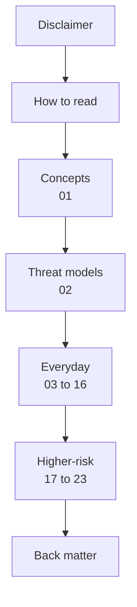

# A Practical Guide to Online Privacy.

> ## IMPORTANT: Read the [Disclaimer and Limitation of Liability](guide/disclaimer.md) first
>
> This guide is general information only. It is not legal or professional security advice, it cannot guarantee privacy, anonymity, or security, and you are responsible for how you use it. If you face stalking, coercion, targeted surveillance, or other serious threats, get qualified help before changing anything that could affect your safety.
>
> **[Read the full disclaimer](guide/disclaimer.md)**

A practical, plain-English guide to protecting your privacy online. The first part covers everyday habits that help almost everyone. The second part covers higher-risk situations and assumes you have the everyday baseline in place.

*Last reviewed: 2026-10-21.* Apps, settings menus, and laws change. Recheck any specific setting against the vendor's current documentation (see [further reading](guide/further-reading.md)).

---

## Table of contents

- [Scope](#scope)
- [How the chapters are laid out](#how-the-chapters-are-laid-out)
- [Start here](#start-here)
- [Everyday chapters](#everyday-chapters)
- [Higher-risk chapters](#higher-risk-chapters)
- [Back matter](#back-matter)
- [Reading order](#reading-order)
- [Website](#website)
- [License](#license)

## Scope

- Defensive privacy only: reducing what companies, criminals, and other people can learn about you.
- Not legal advice. Laws on encryption, searches, and data access differ by country.
- No tool in this guide makes you anonymous or safe on its own. Each chapter states what a step protects and what it leaves exposed.
- See the [Disclaimer and Limitation of Liability](guide/disclaimer.md) for the full terms of use.

[↑ Back to TOC](#toc)

## How the chapters are laid out

Each chapter follows the same shape: who it is for, what leaks, concrete steps, what the steps do not fix, and a short checklist.

[↑ Back to TOC](#toc)

## Start here

1. **[Disclaimer and Limitation of Liability](guide/disclaimer.md)**
2. [How to read this guide](guide/00-how-to-read.md)
3. [Privacy, security, and anonymity](guide/01-privacy-security-anonymity.md)
4. [Threat models](guide/02-threat-models.md)

Pick your threat level (0 to 6) in chapter 2 before choosing tools. Most people need chapters 3 to 16 and nothing more. Chapter 2 also summarizes what a well-secured computer looks like at each level.

[↑ Back to TOC](#toc)

## Everyday chapters

| # | Chapter | Covers |
|---|---------|--------|
| 00 | [How to read this guide](guide/00-how-to-read.md) | Scope, limits, how to use the checklists |
| 01 | [Privacy, security, anonymity](guide/01-privacy-security-anonymity.md) | Three different goals |
| 02 | [Threat models](guide/02-threat-models.md) | Seven threat levels (0 to 6), with computer security per level |
| 03 | [Accounts](guide/03-accounts.md) | Passwords, passkeys, 2FA, recovery |
| 04 | [Email](guide/04-email.md) | Primary inbox, aliases, provider visibility |
| 05 | [Browsers](guide/05-browsers.md) | Tracking, fingerprinting, extensions |
| 06 | [Search, DNS, and network](guide/06-search-dns-network.md) | Search engines, Wi-Fi, VPN limits |
| 07 | [Messaging](guide/07-messaging.md) | Encrypted chat and metadata |
| 08 | [Social media](guide/08-social-media.md) | Profiles, audiences, linkage |
| 09 | [Phones](guide/09-phones.md) | Permissions, app stores, backups |
| 10 | [Computers and computer security](guide/10-computers.md) | Disk encryption, secure boot, hardening, backups, tiered by threat level |
| 11 | [Files, cloud, and backups](guide/11-files-cloud-backups.md) | Sync, shared links, photo libraries |
| 12 | [Payments](guide/12-payments.md) | Cards, shop accounts, loyalty programs |
| 13 | [Home and devices](guide/13-home-and-devices.md) | Router, speakers, cameras, TVs |
| 14 | [Households](guide/14-households.md) | Shared devices, family accounts, children |
| 15 | [Data brokers and breaches](guide/15-data-brokers-and-breaches.md) | Opt-outs and breach response |
| 16 | [Account takeover](guide/16-account-takeover.md) | Recovering a compromised account |

[↑ Back to TOC](#toc)

## Higher-risk chapters

For people facing a specific adversary, such as an abusive partner with access to their devices, an employer, a government, a litigant, or a coordinated harasser. Each chapter names the adversary it addresses.

| # | Chapter | Covers |
|---|---------|--------|
| 17 | [Targeted threats](guide/17-targeted-threats.md) | Capabilities and limits of a determined adversary |
| 18 | [Compartments](guide/18-compartments.md) | Separating identities, devices, accounts |
| 19 | [Device seizure](guide/19-device-seizure.md) | Lock screens, encryption, border and protest contexts |
| 20 | [Metadata](guide/20-metadata.md) | Who, when, and where |
| 21 | [Anonymity tools](guide/21-anonymity-tools.md) | Tor and VPNs, and their limits |
| 22 | [Travel and public space](guide/22-travel-and-public-space.md) | Protests, travel, shared computers |
| 23 | [If compromised](guide/23-if-compromised.md) | Account takeover vs targeted intrusion, getting help |

[↑ Back to TOC](#toc)

## Back matter

- **[Disclaimer and Limitation of Liability](guide/disclaimer.md)**
- [Glossary](guide/glossary.md)
- [Further reading](guide/further-reading.md)

[↑ Back to TOC](#toc)

## Reading order

[↑ Back to TOC](#toc)

## Website

The `web/` folder is a ready-to-upload static website version of this guide. Upload its contents to any sub-folder on a web host; no server software is needed. See [tools/README.md](tools/README.md) for publishing and rebuilding.

[↑ Back to TOC](#toc)

## License

This project is licensed under the
Creative Commons Attribution-NonCommercial-ShareAlike 4.0 International (CC BY-NC-SA 4.0).

https://creativecommons.org/licenses/by-nc-sa/4.0/

See [LICENSE.md](LICENSE.md). The [Disclaimer and Limitation of Liability](guide/disclaimer.md) also applies.

[↑ Back to TOC](#toc)

---

© 2026 UncleJS — Licensed under CC BY-NC-SA 4.0
